# Exploratory data analysis: strict dataset

Dataset: the strict relevant set (videos the screening kept as relevant: human-labeled relevant plus model-selected strict-zone videos). 160 videos (youtube 95, tiktok 65). Collection date used as the reference date: 2026-10-31.
All numbers in this report are generated by `scripts/run_eda.py` from the data; nothing is typed by hand.
Statistical tests treat videos as independent, although some creators contribute many videos, so p-values are optimistic; effect sizes and confidence intervals are therefore reported, and `scripts/run_eda_robustness.py` repeats the key results with a cap on videos per creator.

## 0. Data quality checks

Checks run before any analysis, so that charts and tests are not built on broken data.

- 160 videos (YouTube 95, TikTok 65); duplicate video ids: 0.
- YouTube: missing likes 11.6%, comments 54.7%, followers 3.2%, description 22.1%, tags 44.2%, hashtags 82.1%.
- TikTok: missing likes 0.0%, comments 0.0%, followers 0.0%, description 100.0%, tags 100.0%, hashtags 18.5%.
- TikTok has no separate description or tags (the caption is stored as the title), so 100% missing there is by design, not a data problem.
- No impossible values found (negative counts, likes or comments above views, future upload dates).

Tables: `tables/00_data_quality.csv`, `tables/00_missingness_pct.csv`, `tables/00_extremes.csv`

*Note: Likes and comments can be hidden or disabled by the creator, so 'missing' there is a platform setting, not a data error. Shares and saves exist only on TikTok.*

## 1. Derived features

Columns created for the analysis (duration groups, rates, dates, age group, subtopic, detected language). They come from keyword rules and text, are not human-validated, and are saved in the features file.

- Age group in the text: YouTube: child (age not given) 45%, not stated in text 27%, infant 13%; TikTok: child (age not given) 45%, infant 32%, not stated in text 11%.
- Language detection method: langdetect 141, too_short 19. Texts with fewer than 25 letters are labeled 'und' (undetermined).

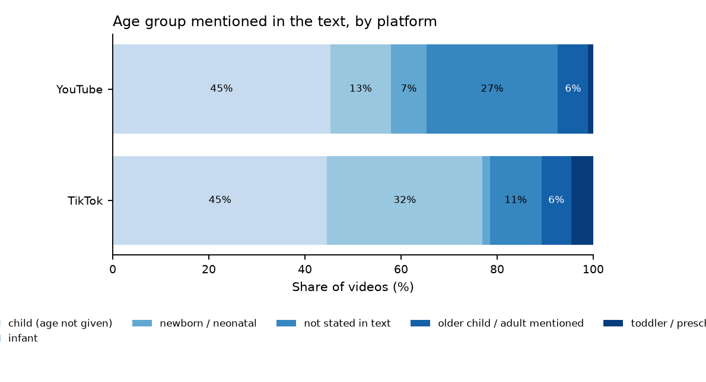

Tables: `tables/01_age_group_by_platform.csv`, `tables/01_subtopic_by_platform.csv`, `tables/01_language_by_platform.csv`, `tables/01_followers_by_platform.csv`

*Note: Subtopic and age group come from keyword matching on title, hashtags, tags and description. They are descriptive labels, not validated against human labels. The setting (subtopic) is the first one found in the order trauma, dental, imaging, needle, wound care, examination, neonatal, safety, alternatives, so a video that names two settings is counted once. Language detection on short social-media captions is error-prone, and Roman Urdu or Hindi written in Latin letters cannot be told apart from other Latin-script languages.*

## 2. Dataset overview

Who and what is in the final dataset.

- YouTube: 95 videos (59.4% of the dataset) from 89 creators; median 1 and maximum 2 videos per creator; the top 10 creators contribute 16.8% of the videos (Gini 0.059); total length 12.5 hours.
- TikTok: 65 videos (40.6% of the dataset) from 62 creators; median 1 and maximum 2 videos per creator; the top 10 creators contribute 20.0% of the videos (Gini 0.044); total length 0.8 hours.
- Videos found by two or more of the 25 queries: YouTube 45%, TikTok 29%.
- Decision source: 104 videos have a human label and 56 were scored by the model.

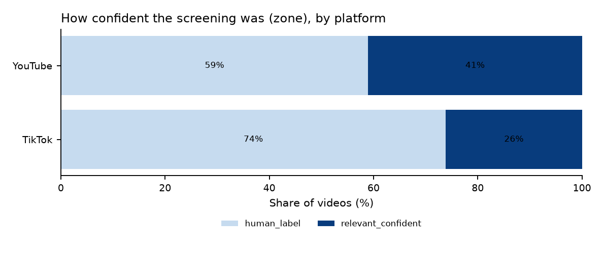

Tables: `tables/02_overview_by_platform.csv`, `tables/02_top_creators.csv`, `tables/02_zone_by_platform.csv`

*Note: These are the videos the platforms returned for the 25 queries on one day, not a random sample of all videos on the topic.*

## 3. Video duration

How long are the videos, and do the platforms differ?

- YouTube: median 248 s (4.1 min); middle half of videos between 136 and 452 s; shortest 25 s, longest 51 min; 8% are 60 seconds or shorter and 21% are longer than 10 minutes.
- TikTok: median 30 s (0.5 min); middle half of videos between 18 and 60 s; shortest 5 s, longest 3 min; 75% are 60 seconds or shorter and 0% are longer than 10 minutes.
- Duration: YouTube median 248 s vs TikTok median 30 s (difference +218 s, 95% CI +183 to +300); Mann-Whitney p < 0.001; Cliff's delta +0.88 (95% CI +0.80 to +0.93), large effect (positive = YouTube tends to be larger).

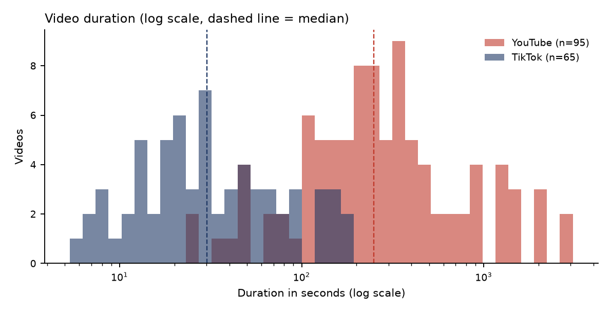

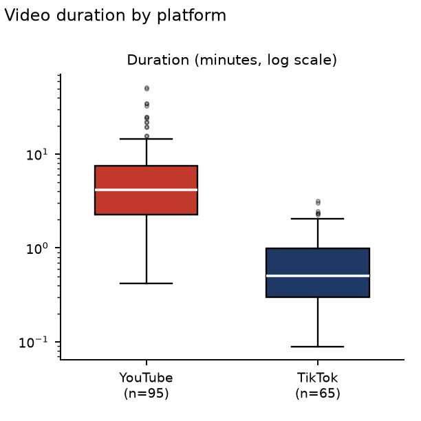

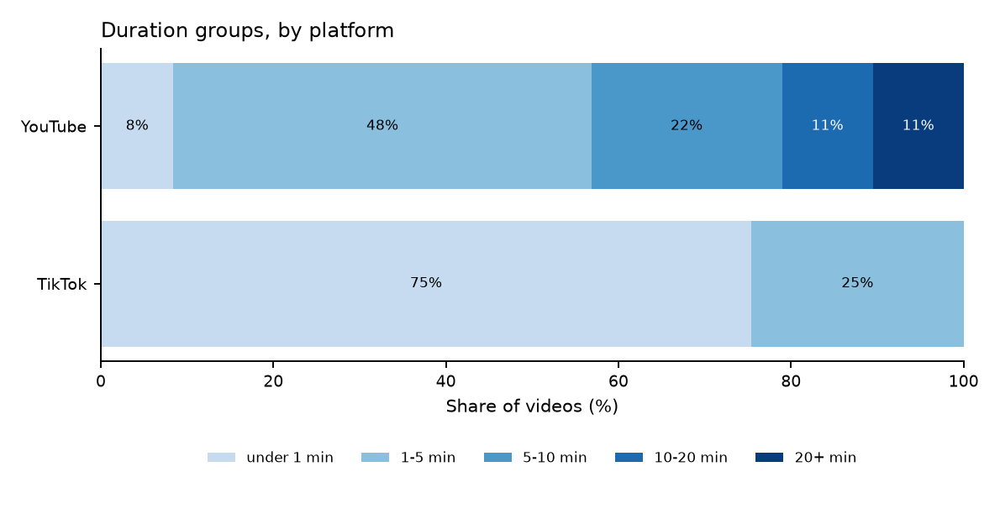

Tables: `tables/03_duration_summary_seconds.csv`, `tables/03_duration_groups.csv`, `tables/03_duration_test.csv`

*Note: Duration is strongly right-skewed, so medians, quartiles and a log scale are used instead of means. A YouTube video of 60 seconds or less may be a Short; the data do not say.*

## 4. Views

How often are the videos watched, and how concentrated are the views?

- YouTube: median 2,037 views (middle half 482 to 20,054); maximum 4,386,845. 36.8% of videos have fewer than 1,000 views and 4 have a million or more. The 10 most viewed videos account for 92.4% of all views and the top 10% of videos for 89.9% (Gini 0.919).
- TikTok: median 11,004 views (middle half 1,911 to 44,602); maximum 7,257,533. 15.4% of videos have fewer than 1,000 views and 3 have a million or more. The 10 most viewed videos account for 92.9% of all views and the top 10% of videos for 88.6% (Gini 0.917).
- Views: YouTube median 2,037 vs TikTok median 11,004 (difference -8,967, 95% CI -15,205 to -1,659); Mann-Whitney p = 0.009; Cliff's delta -0.24 (95% CI -0.42 to -0.06), small effect (positive = YouTube tends to be larger).

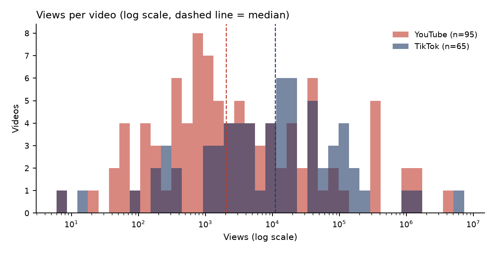

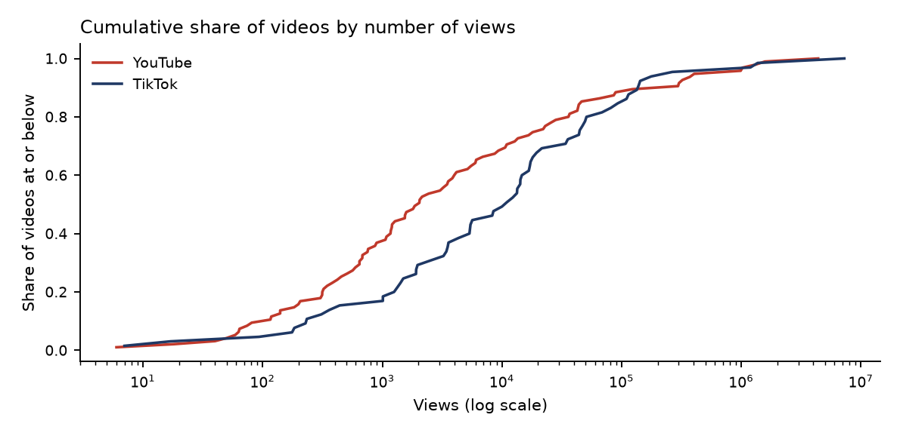

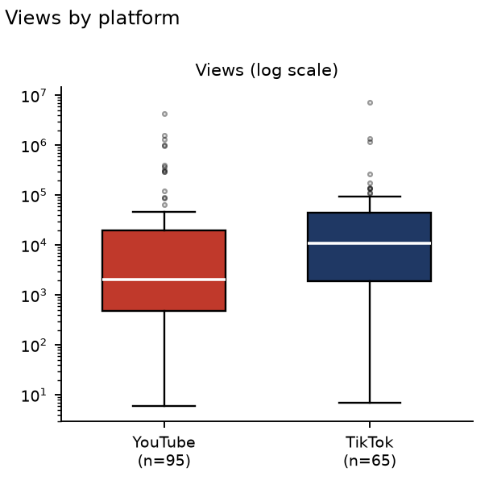

Tables: `tables/04_views_summary.csv`, `tables/04_views_concentration.csv`, `tables/04_views_test.csv`

*Note: Views are highly skewed; a few videos dominate the totals. The platforms count a 'view' differently and the data were collected on one day, so older videos have had longer to gather views. The videos are what search returned and platforms favour popular videos, so these figures describe search results, not all videos.*

## 5. Engagement

How much do viewers react? Rates are in percent of views and are computed only for videos with at least 100 views (rates of videos with very few views are unstable).

- YouTube like rate: median 0.56% (middle half 0.28% to 1.07%), available for 81 of 86 videos with at least 100 views.
- TikTok like rate: median 1.85% (middle half 1.00% to 3.15%), available for 62 of 62 videos with at least 100 views.
- YouTube comment rate: median 0.04% (middle half 0.02% to 0.15%), available for 41 of 86 videos with at least 100 views.
- TikTok comment rate: median 0.05% (middle half 0.01% to 0.10%), available for 62 of 62 videos with at least 100 views.
- Like rate: YouTube median 0.56% vs TikTok median 1.85% (difference -1.29%, 95% CI -1.70 to -0.81); Mann-Whitney p < 0.001; Cliff's delta -0.67 (95% CI -0.79 to -0.54), large effect (positive = YouTube tends to be larger).
- Comment rate: YouTube median 0.04% vs TikTok median 0.05% (difference -0.01%, 95% CI -0.04 to +0.06); Mann-Whitney p = 0.297; Cliff's delta +0.12 (95% CI -0.11 to +0.34), negligible effect (positive = YouTube tends to be larger).
- YouTube: Spearman correlation between log views and like rate rho = -0.14 (n = 81).
- TikTok: Spearman correlation between log views and like rate rho = +0.07 (n = 62).
- TikTok only: median share rate 0.09% and median save rate 0.15% of views.

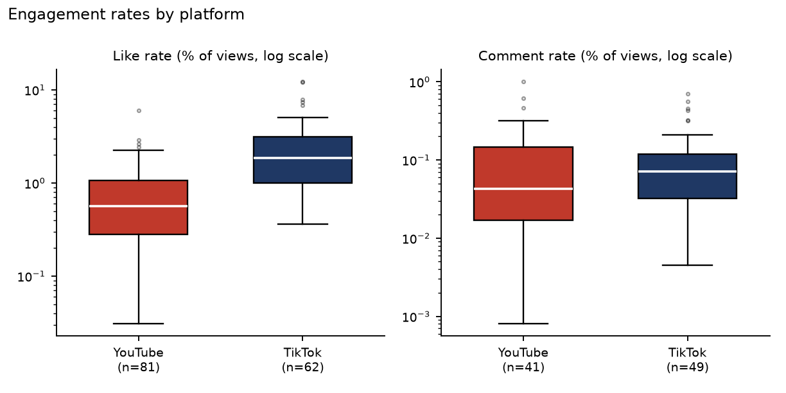

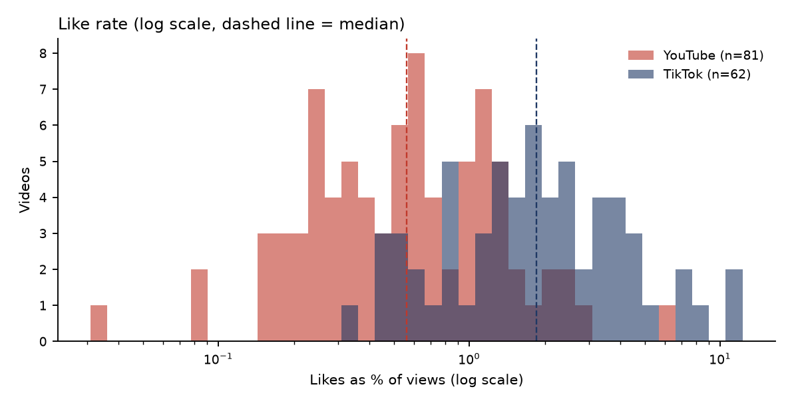

Tables: `tables/05_engagement_summary.csv`, `tables/05_engagement_tests.csv`, `tables/05_tiktok_share_save_rates.csv`, `tables/05_rate_vs_views_correlation.csv`

*Note: Videos with a rate of exactly zero (for example no comments: YouTube 0, TikTok 13) cannot be drawn on a log scale, so they are left out of the box plots only; the statistics include them.*
*Note: YouTube creators can hide likes or disable comments, and those videos are excluded from the rates, so the YouTube rates describe the videos where the counts are visible. The platforms differ in how people react (TikTok has shares and saves, YouTube has long watch sessions), so rates are compared with care and only descriptively.*

## 6. Upload trends

When were the videos uploaded, and how does the observed dataset vary over time?

- Upload years in the dataset range from 2010 to 2026; 38 videos were uploaded in 2026.
- Highest observed upload months: 2026-10 (6), 2026-01 (5), 2026-08 (5).

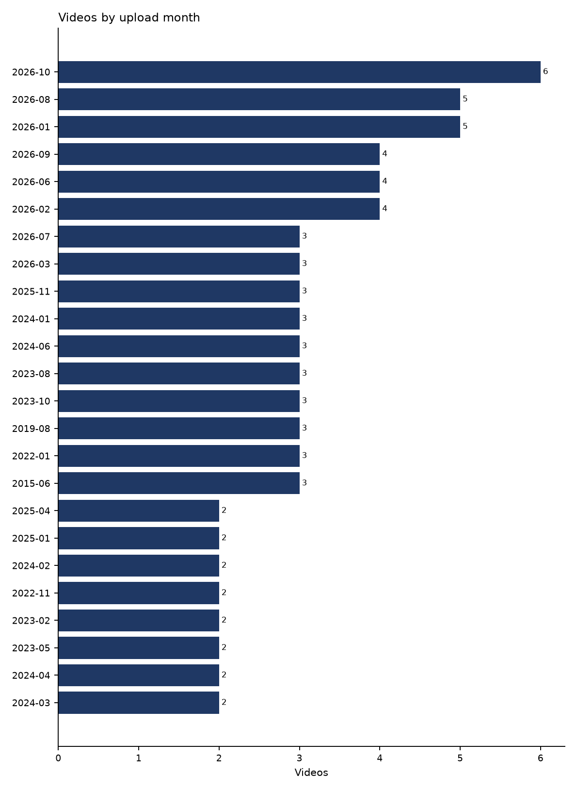

Tables: `tables/06_uploads_by_month.csv`, `tables/06_uploads_by_year.csv`

*Note: These are counts among videos returned by the 25 queries on the collection date; they are not a complete measure of how much content was published on each date.*

## 7. Language and country

What languages and countries are represented in the final relevant dataset?

- YouTube: most common detected language is en (80 videos).
- TikTok: most common detected language is en (43 videos).
- Country metadata are available mainly where the platform reports a country; the top reported country is US (37 videos).

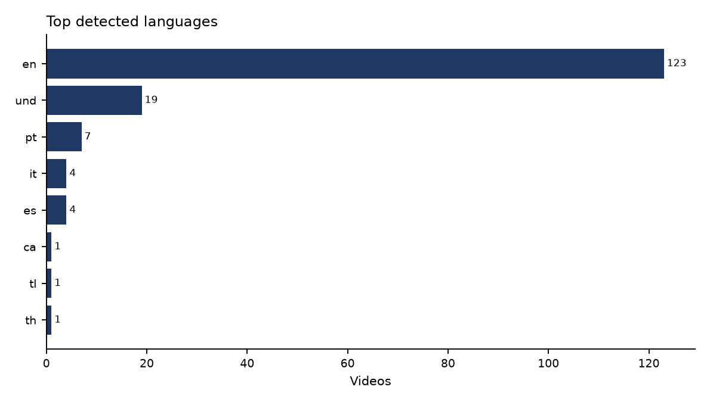

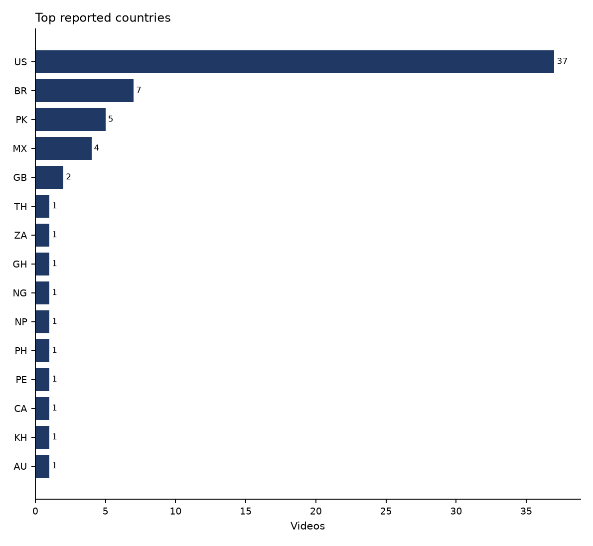

Tables: `tables/07_language_detected.csv`, `tables/07_country.csv`

*Note: Detected language is text-based and can be uncertain for short captions. Roman Urdu/Hindi written in Latin script cannot be reliably separated by this method. Country is platform-reported metadata, not a verified creator residence.*

## 8. Creator analysis

How concentrated is the relevant content among creators?

- YouTube: 89 creators for 95 videos; median 1 video per creator and maximum 2; top 10 creators contribute 16.8% of videos.
- TikTok: 62 creators for 65 videos; median 1 video per creator and maximum 2; top 10 creators contribute 20.0% of videos.

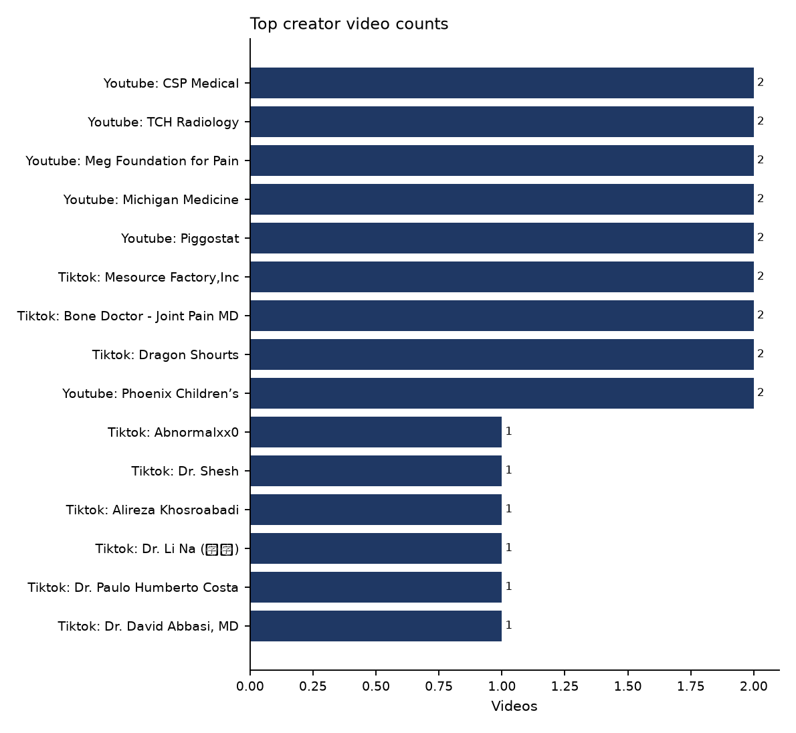

Tables: `tables/08_creator_summary.csv`, `tables/08_top_creators.csv`

*Note: Creator concentration is descriptive. The dataset is search-result based, so it does not represent the complete creator population.*

## 9. Subtopics

Which clinical settings appear most often in the videos?

- Most common detected subtopics: imaging (MRI, X-ray, CT) (36), needle procedures (28), not specified in text (27), trauma / spinal / splint (24), holding / restraint (no setting named) (17).

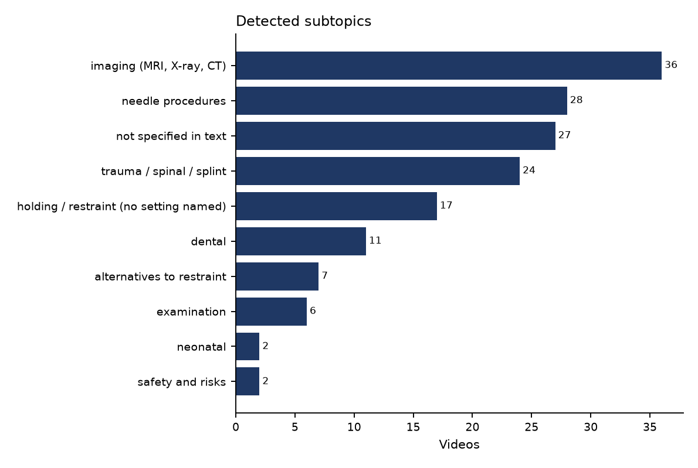

Tables: `tables/09_subtopics.csv`

*Note: Subtopics are keyword-derived from title, hashtags, tags and description. They describe text signals and do not prove that every listed procedure is actually taught in the video.*

## 10. Query analysis

Which search queries and query counts are associated with the final relevant videos?

- YouTube: median query count per relevant video is 1; maximum is 6.
- TikTok: median query count per relevant video is 1; maximum is 4.
- Most frequent query-subtopic labels among relevant rows: imaging (46), general (38), needle_procedures (27), trauma_spinal (24), alternatives (19).

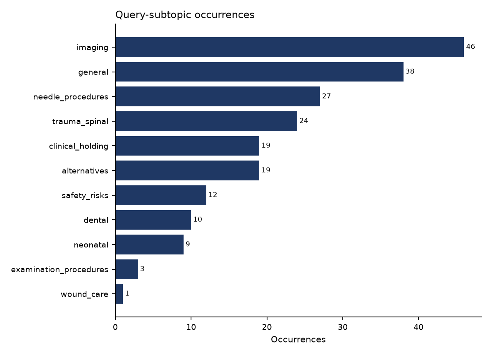

Tables: `tables/10_query_count_summary.csv`, `tables/10_query_subtopic_counts.csv`

*Note: Query/subtopic fields record how videos were discovered; they are not video-level human topic labels.*

## 11. Text analysis

What simple text characteristics are visible in titles and hashtags?

- YouTube title length: median 6 words (middle half 4-10).
- TikTok title length: median 46 words (middle half 15-94).

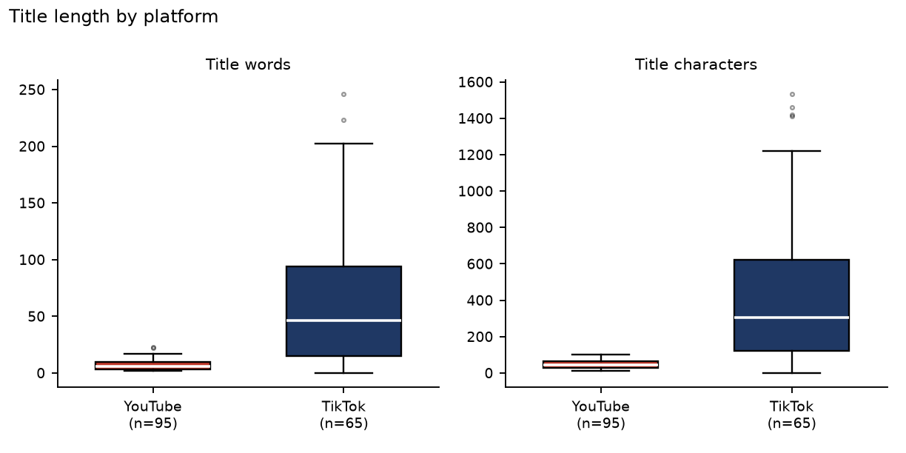

Tables: `tables/11_text_length_summary.csv`

*Note: This is a descriptive text analysis of available metadata, not a semantic analysis of the video content itself.*

## 12. Transcripts and usable text

The screening model reads title, description, hashtags and the transcript. How much text do the videos have, and is a transcript linked to being selected as relevant?

- YouTube: 1 of 95 videos (1.1%) have a usable transcript; 14 (14.7%) have almost no text at all (fewer than 6 words in title, description and transcript).
- TikTok: 28 of 65 videos (43.1%) have a usable transcript; 7 (10.8%) have almost no text at all (fewer than 6 words in title, description and transcript).

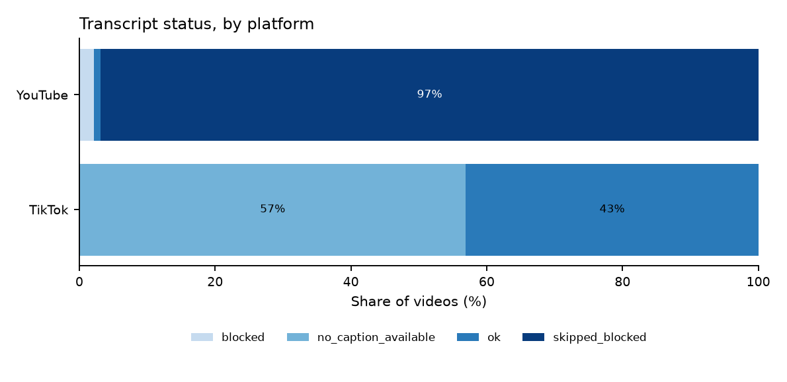

Tables: `tables/12_text_availability_by_platform.csv`, `tables/12_transcript_status_by_platform.csv`

*Note: Most TikTok videos carry only a caption; YouTube transcripts can be missing because of platform blocks or disabled captions. Missing text lowers what the model and the keyword checklist can see; it does not mean the video is irrelevant.*

## 13. Techniques mentioned

Which holding, restraint and safety terms appear in the text? A video can mention several. These are word matches in the title, hashtags, tags and description, not proof that the technique is shown.

- Most mentioned: words restraint / immobilization / stabilization (62), papoose / immobilization device (36), distraction / child life (14), comfort position / parent hold (12).
- 60% of the videos mention at least one of these techniques; the rest are described only in general terms.

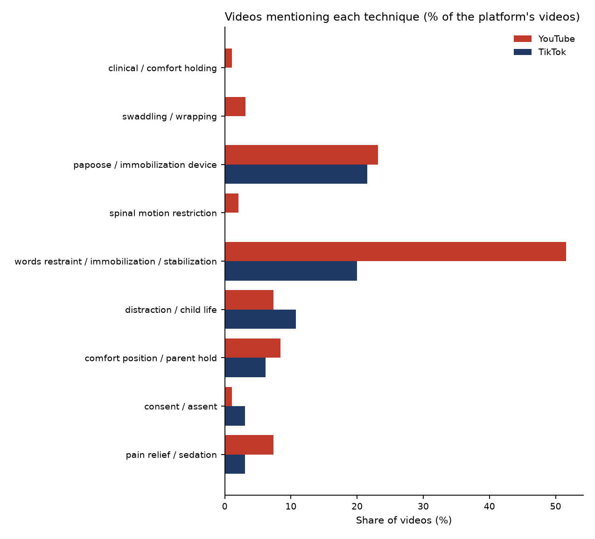

Tables: `tables/13_technique_mentions_by_platform.csv`

*Note: The same vocabulary drives the screening rules, so this section describes the data and is not an independent check of the screening.*

## 14. Screening outcome

How did the screening sort the videos (relevant, audit, irrelevant), and how do the groups differ? Only meaningful on the dataset that holds all three groups.

*Note: This dataset holds a single screening group, so there is nothing to compare. Run the 'all' dataset for this section.*
